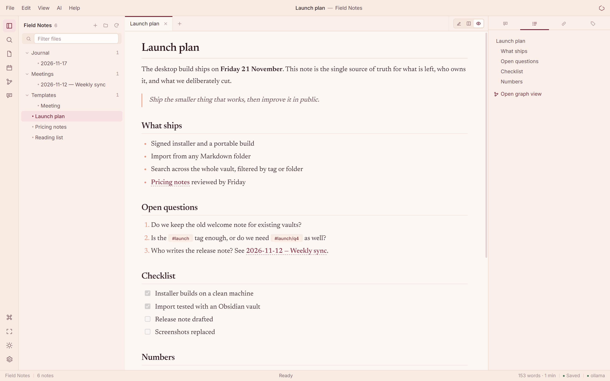
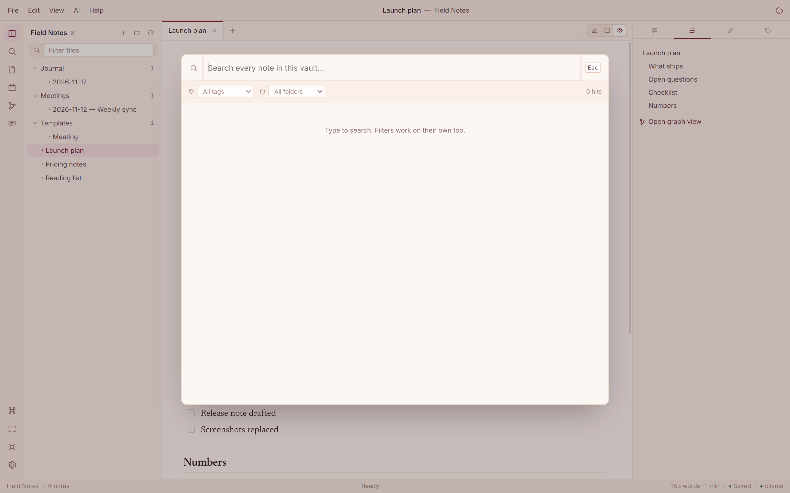
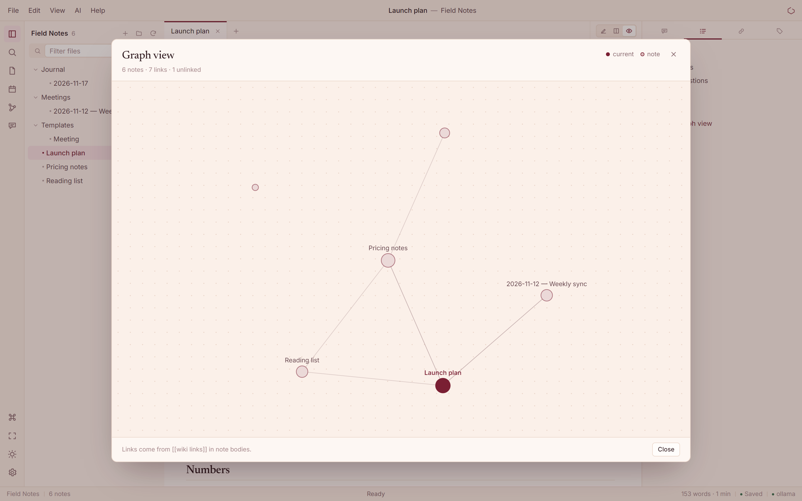
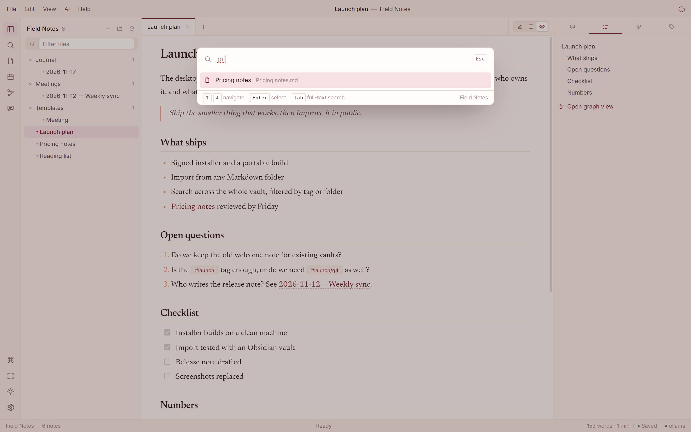

# Carbon

**A local-first Markdown app for Windows.** Your notes are plain files in a folder you choose — with links, full-text search, a note graph, daily notes, templates, export and import built in. AI is optional.

[](https://github.com/heyitsyajat/carbon/releases/latest)
[](LICENSE)
[](#requirements)
[](https://www.electronjs.org/)



## Download

| Build | Best for | |
| --- | --- | --- |
| **Installer** | Normal use — Start menu and desktop shortcuts, per-user install | [Carbon-1.0.0-Setup.exe](https://github.com/heyitsyajat/carbon/releases/latest/download/Carbon-1.0.0-Setup.exe) |
| **Portable** | Running from a USB stick or without installing | [Carbon-1.0.0-Portable.exe](https://github.com/heyitsyajat/carbon/releases/latest/download/Carbon-1.0.0-Portable.exe) |

Both are 64-bit Windows builds. See [Releases](https://github.com/heyitsyajat/carbon/releases) for notes and checksums.

> **Unsigned build.** Carbon is not code-signed, so Windows SmartScreen may show “Windows protected your PC”. Choose **More info → Run anyway**, or check the published SHA-256 checksum first. Signing instructions for maintainers are in [`.github/workflows/release.yml`](.github/workflows/release.yml).

## Contents

- [Why Carbon](#why-carbon)
- [Features](#features)
- [AI is optional](#ai-is-optional)
- [Requirements](#requirements)
- [Keyboard shortcuts](#keyboard-shortcuts)
- [Screenshots](#screenshots)
- [Development](#development)
- [Privacy](#privacy)
- [License](#license)

## Why Carbon

Most note apps ask you to trust a database and a subscription. Carbon does the opposite:

- **A vault is a folder.** Every note is a `.md` file. Open the same folder in any editor, sync tool or backup, and keep it forever.
- **No account and no server.** There is nothing to sign up for, nothing to sync through us, and no telemetry.
- **AI where you want it.** Run a local model, point at any OpenAI-compatible endpoint, or use your own key — or skip AI entirely and lose no note-taking features.
- **Keyboard-first.** A quick switcher, command palette, vault search, daily notes and remappable shortcuts.

## Features

### Find what you wrote
- **Quick switcher** (`Ctrl+O`) — fuzzy jump to a note by title, path or tag. Type `tag:` to narrow by tag.
- **Vault search** (`Ctrl+Shift+F`) — full-text search with tag and folder filters, matching lines and a snippet.
- **Command palette** (`Ctrl+P`) — every command, discoverable by name.
- **Tag index** — every tag in the vault with note counts; click to search that tag.

### Connect notes
- **Wiki links** — `[[Note name]]` links notes. Unresolved links can be turned into notes in one click.
- **Backlinks and mentions** — outgoing links, backlinks, and unlinked mentions of the current note's title.
- **Graph view** (`Ctrl+G`) — force layout of the vault; node size follows link count, click to open.

### Write and organise
- **Daily notes** (`Ctrl+D`) — configurable folder, filename pattern and template.
- **Templates** (`Ctrl+Shift+T`) — `{{date}}`, `{{date:dddd D MMMM}}`, `{{time}}` and `{{title}}`, saved in your templates folder.
- **Meeting notes** (`Ctrl+Shift+M`) — timestamped template with attendees, decisions and action items; paste a transcript for an AI summary when configured.
- **Markdown editor** — CodeMirror with live preview, split view, focus mode and adjustable text width.
- **Export and import** — Markdown, HTML or PDF per note; import an Obsidian vault or any Markdown folder.

### Make it yours
- **Focus mode** (`Ctrl+Alt+F`) — hides sidebars and centres the editor.
- **Shortcut editor** — remap any command in Settings → Shortcuts, with duplicate detection.
- **Quiet, consistent interface** — peach and burgundy themes, local fonts, remembered window bounds and sidebar widths, subtle autosave status.
- **Clear failure states** — errors explain what happened and the next step instead of showing raw exceptions.

## AI is optional


Setup asks once, with two equal choices: **Set up AI provider** or **Continue without AI**. Choosing the second leaves every note feature working; assistant surfaces show a short “Add an AI provider in Settings” prompt instead of an error, and the wizard does not appear again.

You can add or change a provider at any time in **Settings → AI**:

| Backend | What it needs | Where text goes |
| --- | --- | --- |
| Local (Ollama) | Ollama at `http://127.0.0.1:11434` | Stays on this computer |
| OpenAI-compatible | Any `/v1` chat-completions endpoint (LM Studio, vLLM, OpenRouter, your gateway) | The endpoint you configure |
| OpenAI / Anthropic | Your own API key | The provider you choose |

Only the text an action needs is sent: the current note, or the selection if there is one. API keys are encrypted with Windows secure storage, never written to the settings file, and never exposed to the editor process.

## Requirements

- Windows 10 or 11, 64-bit
- No runtime, account or network connection required for local use

## Keyboard shortcuts

| Shortcut | Action | Shortcut | Action |
| --- | --- | --- | --- |
| `Ctrl+O` | Quick switcher | `Ctrl+N` | New note |
| `Ctrl+P` | Command palette | `Ctrl+Shift+N` | New folder |
| `Ctrl+Shift+F` | Search the vault | `Ctrl+Shift+M` | New meeting note |
| `Ctrl+G` | Graph view | `Ctrl+D` | Today's note |
| `Ctrl+S` | Save now | `Ctrl+Shift+T` | Insert template |
| `Ctrl+W` | Close tab | `Ctrl+Shift+E` | Export note |
| `Ctrl+B` | Toggle file list | `Ctrl+E` | Editor / split / preview |
| `Ctrl+Shift+B` | Toggle side panel | `Ctrl+Alt+F` | Focus mode |
| `Ctrl+K` | Writing assistant | `Ctrl+,` | Settings |
| `F1` | Instructions | `Ctrl+Shift+Backspace` | Delete note |

Every binding can be changed in **Settings → Shortcuts** and is listed in **Help → Instructions**.

## Screenshots

| | |
| --- | --- |
|  |  |
| Full-text search, filtered by tag or folder | Graph view with the current note highlighted |
|  |  |
| Quick switcher with fuzzy matching | The dark theme |

Screenshots are captured from the real app with an isolated profile — see [Development](#development).

## Development

Prerequisites: Node.js 20+ and npm. Git Bash or PowerShell for the scripts.

```bash
npm run install:all     # root, app and website dependencies
npm run dev             # Vite dev server + Electron (hot reload)
npm run typecheck       # both TypeScript projects
npm run lint            # ESLint, zero warnings
npm test                # Vitest unit tests
npm run build           # main, preload and renderer bundles
npm run dist            # NSIS installer + portable build in app/release
npm run website:dev     # landing page at http://localhost:5173
```

### Project layout

```
app/                    Electron application
  src/main/               windows, menus, vault access, settings, secrets, AI service, exporter
  src/shared/             types, IPC contract, Markdown, templates, graph, fuzzy search, export, keybindings
  src/renderer/           React UI, CodeMirror editor, design tokens, local fonts
  build/                  generated logo, PNG icons and icon.ico
  scripts/                build, brand generation, demo vault, screenshot capture
website/                Vite + React landing page using the same tokens and brand assets
.github/workflows/      CI, Windows release and landing-page deployment
```

### Architecture notes

- **Main process owns the filesystem and secrets.** The renderer talks through a typed IPC bridge (`src/shared/ipc.ts`); it never receives API keys. Keys live in a safeStorage-encrypted `secrets.json`.
- **Every path is validated.** Vault access resolves paths inside the vault root and rejects anything that escapes it (`src/shared/paths.ts`).
- **Shared logic is pure and tested.** Fuzzy matching, template expansion, graph layout, export documents, keybinding normalisation and error translation live in `src/shared` with tests in `src/main/__tests__`.
- **AI is opt-in.** `ai.enabled` gates every request; disabled requests explain how to add a provider rather than throwing.

### Brand and screenshots

One geometry script generates the mark, icons and installer icon:

```bash
npm --prefix app run icon   # writes app/build/ and website/public/brand/
```

Screenshots come from the real app using a throwaway vault and profile:

```bash
cd app
node scripts/make-demo-vault.mjs
npm run build
node scripts/capture-screenshots.mjs light
```

`CARBON_USER_DATA` points Carbon at a separate profile, so capture runs never touch your own vault or settings.

## Privacy

No accounts, no analytics, no update pings, no background network traffic. The only outbound request is the AI call you explicitly start, to the backend you configured. Local models keep even that on your machine.

## License

[MIT](LICENSE) © 2026 Yajat Dayal
