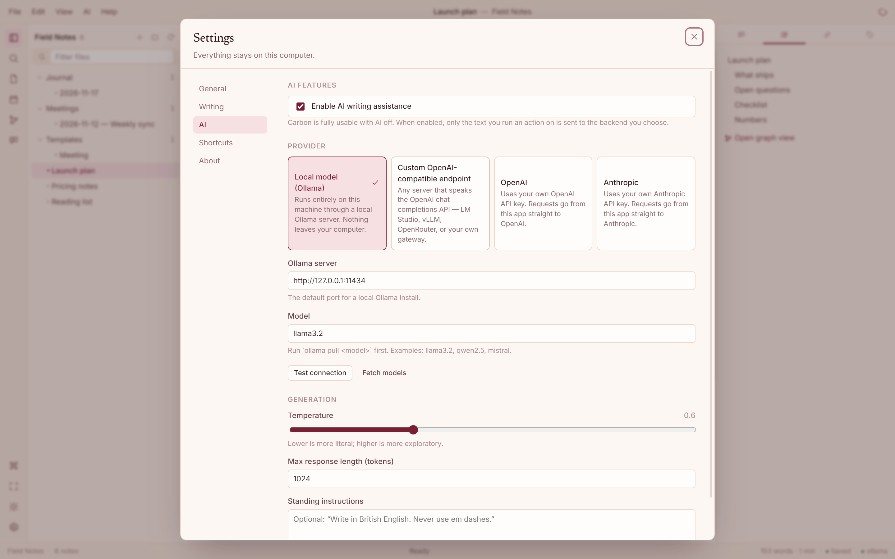
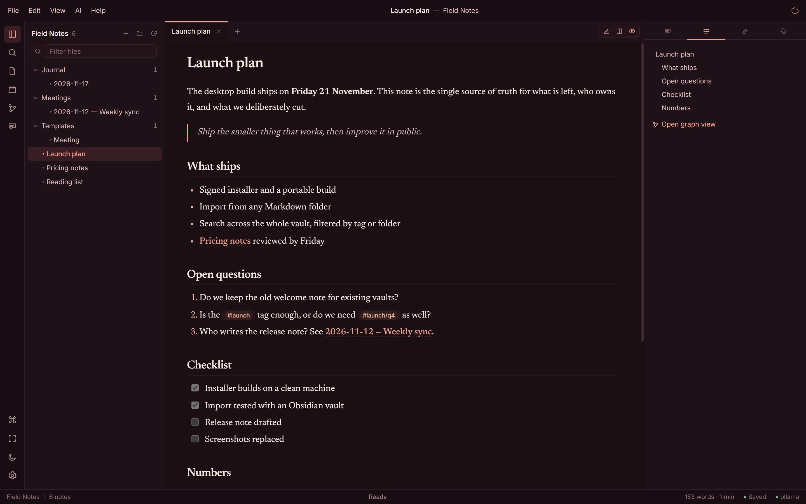

# Carbon

**A local-first Markdown app for Windows.** Notes are plain files in a folder you choose — with links, full-text search, a note graph, daily notes and templates built in. AI is optional, and when you turn it on it can read your selection, the open note, or several notes at once.

[](https://github.com/heyitsyajat/carbon/releases/latest)
[](LICENSE)
[](#requirements)
[](https://www.electronjs.org/)


## Download

| Build | Best for | |
| --- | --- | --- |
| **Installer** | Normal use — Start menu and desktop shortcuts, per-user install | [Carbon-1.0.0-Setup.exe](https://github.com/heyitsyajat/carbon/releases/latest/download/Carbon-1.0.0-Setup.exe) |
| **Portable** | Running from a USB stick or without installing | [Carbon-1.0.0-Portable.exe](https://github.com/heyitsyajat/carbon/releases/latest/download/Carbon-1.0.0-Portable.exe) |

64-bit Windows 10 or 11. See [Releases](https://github.com/heyitsyajat/carbon/releases) for notes and SHA-256 checksums.

> **Unsigned build.** Carbon is not code-signed, so SmartScreen may show “Windows protected your PC”. Choose **More info → Run anyway**, or verify the checksum against the published `Carbon-1.0.0-SHA256SUMS.txt` first.

### Android

Carbon also ships as a native Android app with the same warm theme, vault model and assistant. It lives in [`android/`](android/): Kotlin, Jetpack Compose and plain Markdown files in app-specific storage. Build an installable APK with:

```bash
cd android
./gradlew assembleDebug        # app/build/outputs/apk/debug/app-debug.apk
```

The Android app needs JDK 17 and the Android SDK (platform 35, build-tools 35.0.0). It is not on Google Play; sideload the APK or install it with `adb install`.

## Contents

- [Features](#features)
- [AI, when you want it](#ai-when-you-want-it)
- [AI recipes](#ai-recipes)
- [Requirements](#requirements)
- [Keyboard shortcuts](#keyboard-shortcuts)
- [Screenshots](#screenshots)
- [Development](#development)
- [Privacy](#privacy)
- [License](#license)

## Features

### Notes that stay yours
- **A vault is a folder.** Every note is a `.md` file you can open in any editor, sync with any tool, and back up by copying.
- **Wiki links** — `[[Note name]]` connects notes, with backlinks, outgoing links, unlinked mentions and one-click creation of unresolved links.
- **Graph view** (`Ctrl+G`) — the vault as a force-directed map; node size follows link count, click to open a note.
- **Daily notes** (`Ctrl+D`) — folder, filename pattern and template are configurable.
- **Templates** (`Ctrl+Shift+T`) — `{{title}}`, `{{date}}`, `{{date:dddd D MMMM}}` and `{{time}}`, stored in a vault folder.
- **Meeting notes** (`Ctrl+Shift+M`) — a timestamped template with attendees, decisions and action items.
- **Import and export** — bring in an Obsidian vault or any Markdown folder; export a note as Markdown, HTML or PDF.
- **Delete is reversible.** Notes go to the Windows Recycle Bin, not into the void.

### Find anything
- **Quick switcher** (`Ctrl+O`) — fuzzy match on title, path or tag; `tag:` narrows the search.
- **Vault search** (`Ctrl+Shift+F`) — full text with tag and folder filters, matching lines and snippets.
- **Command palette** (`Ctrl+P`) — run any command without leaving the keyboard.
- **Tag index** — every tag with its note count; click to search it.

### Write without friction
- **CodeMirror editor** with live preview, split view and focus mode (`Ctrl+Alt+F`).
- **Autosave** with an honest saved/dirty indicator, plus explicit `Ctrl+S`.
- **Remappable shortcuts** — every command, with duplicate detection, in Settings → Shortcuts.

## AI, when you want it

Setup offers two equal choices: **Set up AI provider** or **Continue without AI**. Skipping AI loses no note features — assistant buttons simply explain how to add a provider later, and you can change your mind in **Settings → AI** at any time.



Press `Ctrl+K` to open the assistant. It works on **whatever you have selected**: a passage, the whole note, or the open note plus up to five notes selected in the sidebar. The panel tells you which scope it is using before you run anything.

| Action | What it does | Shortcut |
| --- | --- | --- |
| **Continue** | Writes the next 2–4 sentences in your voice, without repeating the last line | `Ctrl+Alt+C` |
| **Rewrite** | Tightens the selected passage, keeping meaning and Markdown | `Ctrl+Alt+R` |
| **Summarize** | 3–6 bullets, most important point first | `Ctrl+Alt+S` |
| **Bullets** | Turns prose into a scannable list | `Ctrl+Alt+B` |
| **Table** | Shapes structured prose into a Markdown table, never inventing cells | `Ctrl+Alt+T` |
| **Actions** | Extracts `- [ ]` checkboxes with owners and dates in bold | `Ctrl+Alt+A` |
| **Ask about this note** | Answers a question with the note as context | — |
| **Custom instruction** | “Tighten the intro”, “Add a risks section”, “Rewrite for a non-technical reader” | — |
| **Meeting transcript** | Paste a transcript and get a summary plus action items | — |

Results stream in and can be **inserted at the cursor, used to replace the selection, appended to the end of the note, or copied** — with a **Stop** button while they generate, and no text changed until you choose.

### Context that makes answers useful

- **Target a passage.** Select text, then hit an action: only that text is sent and replaced.
- **Ask across notes.** Select several notes in the sidebar, then ask “What did we decide about pricing?” — up to five extra notes are attached as context.
- **Meeting mode** turns a pasted transcript into `## Summary` and `## Action items`, pulling owners out only when someone actually said them.
- **Standing instructions.** A custom system prompt in Settings → AI applies to every request (tone, spelling, house style), alongside temperature and max-token limits.
- **Test before you trust it.** *Test connection* lists available models and reports the actual error if a provider is unreachable.

### Providers

| Backend | What it needs | Where text goes |
| --- | --- | --- |
| Local (Ollama) | Ollama at `http://127.0.0.1:11434` | Stays on this computer |
| OpenAI-compatible | Any `/v1` chat-completions endpoint — LM Studio, vLLM, OpenRouter, your own gateway | The endpoint you configure |
| OpenAI | Your own API key | OpenAI |
| Anthropic | Your own Anthropic API key | Anthropic |

API keys are encrypted with Windows secure storage, held by the main process, and never exposed to the editor. Only the text an action needs is sent — no vault scanning, no background requests.

## AI recipes

Copy-paste starting points for the **Custom instruction** box:

| Goal | Instruction | Use with |
| --- | --- | --- |
| Meeting follow-up | “Turn this into a summary and a checklist of owners and deadlines.” | Transcript or meeting note |
| Client email | “Rewrite this as a short, friendly client email. Keep the dates.” | Selection |
| Decision log | “Extract the decisions and their rationale as a table.” | Several notes selected |
| Study notes | “Turn this into question-and-answer flashcards.” | Current note |
| Editorial pass | “Cut 20% of the words without losing meaning.” | Selection |
| Project pulse | “What changed, what is blocked, and what is next?” | Weekly notes selected |
| Documentation | “Explain this code block for a new contributor, then list the assumptions.” | Selection |
| Trip planning | “Organise these notes into an itinerary table with dates and costs.” | Current note |

## Requirements

- Windows 10 or 11, 64-bit for the desktop app
- Android 8.0 (API 26) or newer for the Android app
- No runtime, account or network connection for local note-taking

## Keyboard shortcuts

| Shortcut | Action | Shortcut | Action |
| --- | --- | --- | --- |
| `Ctrl+O` | Quick switcher | `Ctrl+N` | New note |
| `Ctrl+P` | Command palette | `Ctrl+Shift+N` | New folder |
| `Ctrl+Shift+F` | Search the vault | `Ctrl+Shift+M` | New meeting note |
| `Ctrl+G` | Graph view | `Ctrl+D` | Today's note |
| `Ctrl+S` | Save now | `Ctrl+Shift+T` | Insert template |
| `Ctrl+W` | Close tab | `Ctrl+Shift+E` | Export note |
| `Ctrl+B` | Toggle file list | `Ctrl+E` | Editor / split / preview |
| `Ctrl+Shift+B` | Toggle side panel | `Ctrl+Alt+F` | Focus mode |
| `Ctrl+K` | Writing assistant | `Ctrl+,` | Settings |
| `Ctrl+Alt+R` | Rewrite selection | `Ctrl+Alt+S` | Summarize note |
| `Ctrl+Alt+A` | Extract action items | `Ctrl+Alt+C` | Continue writing |
| `F1` | Instructions | `Ctrl+Shift+Backspace` | Delete note |

Every binding can be changed in **Settings → Shortcuts**.

## Screenshots

| | |
| --- | --- |
|  |  |
| Full-text search, filtered by tag or folder | Graph view with the current note highlighted |
|  |  |
| Quick switcher with fuzzy matching | The dark theme |

Screenshots are captured from the real app with an isolated profile — see [Development](#development).

## Development

Prerequisites: Node.js 20+ and npm.

```bash
npm run install:all     # root, app and website dependencies
npm run dev             # Vite dev server + Electron (hot reload)
npm run typecheck       # both TypeScript projects
npm run lint            # ESLint, zero warnings
npm test                # Vitest unit tests
npm run build           # main, preload and renderer bundles
npm run dist            # NSIS installer + portable build in app/release
npm run website:dev     # landing page at http://localhost:5173
```

### Project layout

```
android/                Native Android app (Kotlin, Jetpack Compose)
  app/src/main/java/      data, domain, AI client, Compose UI
  app/src/test/java/      JVM unit tests for Markdown, search, templates, graph
app/                    Electron application
  src/main/               windows, menus, vault access, settings, secrets, AI service, exporter
  src/shared/             types, IPC contract, Markdown, templates, graph, fuzzy search, AI prompts
  src/renderer/           React UI, CodeMirror editor, design tokens, local fonts
  build/                  generated logo, PNG icons and icon.ico
  scripts/                build, brand generation, demo vault, screenshot capture
website/                Vite + React landing page using the same tokens and brand assets
.github/workflows/      CI, Windows release and landing-page deployment
```

### Architecture notes

- **Main process owns the filesystem and secrets.** The renderer talks through a typed IPC bridge (`src/shared/ipc.ts`); it never receives API keys. Keys live in a safeStorage-encrypted `secrets.json`.
- **Every path is validated.** Vault access resolves paths inside the vault root and rejects anything that escapes it (`src/shared/paths.ts`).
- **Prompts are pure functions.** `src/shared/ai/actions.ts` builds every request and is unit tested, so the assistant's behaviour does not depend on UI state.
- **AI is opt-in.** `ai.enabled` gates every request; disabled requests explain how to add a provider rather than throwing.

### Brand and screenshots

One geometry script generates the mark, icons and installer icon:

```bash
npm --prefix app run icon   # writes app/build/ and website/public/brand/
```

Screenshots come from the real app using a throwaway vault and profile:

```bash
cd app
node scripts/make-demo-vault.mjs
npm run build
node scripts/capture-screenshots.mjs light
```

`CARBON_USER_DATA` points Carbon at a separate profile, so capture runs never touch your own vault or settings.

## Privacy

No accounts, no analytics, no update pings, no background network traffic. The only outbound request is the AI call you explicitly start, to the backend you configured. With Ollama, even that stays on your machine.

## License

[MIT](LICENSE) © 2026 Yajat Dayal
